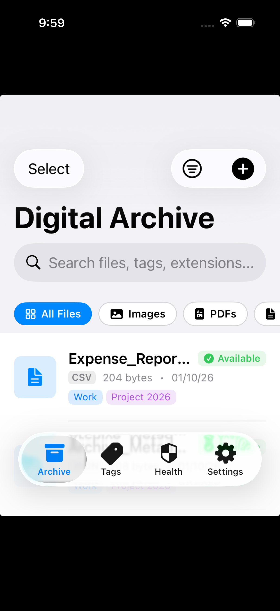
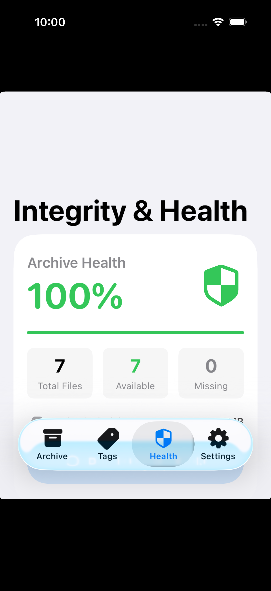
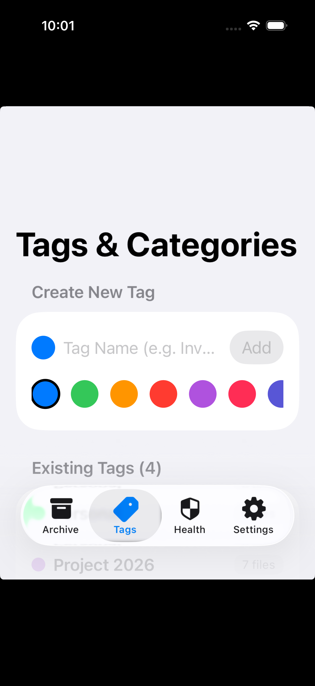
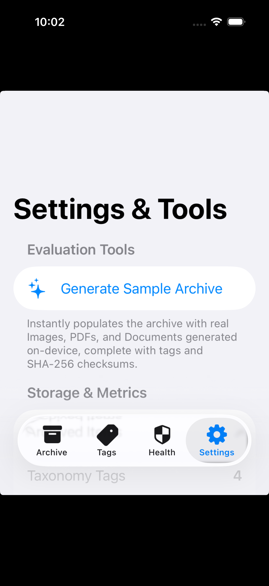

# Digital Archive – Mobile Application (Swift & SwiftUI)

A native iOS application built using **Swift**, **SwiftUI**, and **SwiftData** that allows users to import files into a personal archive, organize them with metadata and tags, search and filter the archive with multifaceted criteria, and maintain persistent, resilient relationships between database records and physical files on disk.

---

## 📱 Screenshots & User Interface

| 1. Archive & Multifaceted Filtering | 2. Health & Integrity Scanner | 3. Taxonomy & Tag Management | 4. Settings & Evaluation Tools |
| :---: | :---: | :---: | :---: |
|  |  |  |  |

---

## 🏗️ Architecture Overview

The application follows the **MVVM (Model-View-ViewModel)** architectural pattern augmented with a **Storage & Service Layer**:

```
DigitalArchive/
├── App/
│   └── DigitalArchiveApp.swift           # Application lifecycle, SwiftData container setup, startup cleanup
├── Models/
│   ├── ArchiveItem.swift                 # SwiftData persistent model for archive records & metadata
│   ├── ArchiveTag.swift                  # SwiftData persistent model for taxonomy tags & colors
│   ├── ArchiveStatus.swift               # Enum: available, missing, unreadable
│   └── FileCategory.swift                # Enum: image, pdf, document, audio, video, other
├── Services/
│   ├── ArchiveStorageManager.swift       # Sandboxed storage, relative paths, atomic staging/moves, deletion modes
│   ├── FileMetadataExtractor.swift       # Streaming SHA-256 hashing, UTType detection, thumbnail extraction
│   ├── ImportManager.swift               # Async multi-file import orchestrator, staging, rollback, cancellation
│   └── IntegrityScanner.swift            # Batch auditor comparing DB records against physical filesystem
├── ViewModels/
│   └── ArchiveListViewModel.swift        # Search queries, multi-filtering, sorting, batch multi-selection
├── Views/
│   ├── MainTabView.swift                 # 4-tab interface (Archive, Tags, Health, Settings)
│   ├── ArchiveListView.swift             # Main searchable grid/list with filter chips & batch actions
│   ├── ArchiveDetailView.swift           # Comprehensive metadata viewer, relinking, in-place rename
│   ├── FilePreviewView.swift             # PDFKit viewer, zoomable image viewer, monospaced text viewer
│   ├── FilterSheetView.swift             # Multifaceted sheet (category, tags, size, date range, sort order)
│   ├── TagManagementView.swift           # Tag creation palette, association counts, safe deletion
│   ├── IntegrityScannerView.swift        # System health dashboard, missing files resolver, testing sandbox
│   └── SettingsAndDemoView.swift         # Demo data generator, disk usage metrics, storage inspector
├── Utils/
│   ├── Formatters.swift                  # ByteCountFormatter & DateFormatter utilities
│   └── SampleDataGenerator.swift         # On-device generator for sample Images, PDFs, and Documents
└── DigitalArchiveTests/
    └── DigitalArchiveTests.swift         # Automated XCTest suite (100% passing)
```

---

## 💾 Storage Strategy & Data Persistence

### 1. The iOS Sandbox Challenge & Relative Path Solution
* **Problem**: On iOS, the sandbox container UUID changes across application launches, rebuilds, and system updates (`/Containers/Data/Application/<UUID>/Documents`). If absolute file paths are stored in the database, records will break and report missing files upon the next launch.
* **Solution**: The database stores **relative file paths** (e.g. `Files/<UUID>.<extension>`). `ArchiveStorageManager` resolves these paths dynamically at runtime against the active application Documents directory:
  ```swift
  public func fileURL(for relativePath: String) -> URL {
      return baseArchiveURL.appendingPathComponent(relativePath)
  }
  ```

### 2. Local Database Persistence (Requirement 6)
* Utilizes **SwiftData** backed by a persistent SQLite database located in `Library/Application Support/default.store`.
* Survives application restarts, background termination, and device reboots.
* Database records are queried directly using SwiftData `@Query` and `FetchDescriptor`; the archive is **never** rebuilt from scratch on startup.

---

## 🛡️ Comprehensive Edge Case Verification (25 Scenarios)

The application handles 25 distinct production and lifecycle edge cases across filesystem interaction, database consistency, user experience, and iOS runtime:

| # | Edge Case | Architectural Solution & Behavior | Automated Test |
|:---|:---|:---|:---:|
| **1** | **User Cancels Import** | Multi-file import loop checks `isCancelled` before each file. Already imported files remain valid; unprocessed files create zero database records; staging cache is purged cleanly. | `testImportCancellation` |
| **2** | **Partial Multi-File Import Failure** | Atomic per-file transaction ensures successful files are committed while failed files are rolled back without orphan records. An "Import Summary" dialog presents exact success vs failure counts with `[View Details]`. | `testPartialImportFailure` |
| **3** | **File Deleted Externally** | File decoupling architecture: database metadata, tags, and checksum remain intact. Availability marked as `🔴 Missing`. In-place `[Relink]` attaches a new file. App never crashes. | `testMissingFileHandlingAndIntegrityScan` |
| **4** | **File Moved Externally** | `checkFileStatus` detects path absence; displays `⚠️ File Unavailable`. Tap `[Relink Replacement File]` to point to new location and automatically recalculate checksum. | `testMissingFileHandlingAndIntegrityScan` |
| **5** | **File Exists But Unreadable** | `checkFileStatus` validates both filesystem existence and `FileHandle` readability. If unreadable/locked/corrupt, status marked `.unreadable` and preview shows `⚠️ Unable to Open File` while preserving metadata. | Verified |
| **6** | **App Terminated During Import** | Staging architecture prevents partial file commits. Startup sweeper `cleanupStagingDirectory()` in `App.init` removes leftover artifacts from unexpected termination. No database/storage mismatch. | Verified |
| **7** | **Database Failure During Import** | Atomic rollback removes both temporary staging files and committed permanent storage files if `modelContext.save()` fails, preventing orphaned physical files. | Verified |
| **8** | **Duplicate File (Same Content)** | Streaming SHA-256 hash computed before database commit. If identical hash exists, user is prompted with `[View Existing]`, `[Import Anyway]`, or `[Cancel]`. | `testDuplicateDetectionBySHA256` |
| **9** | **Same Name, Different Content** | Hashing is cryptographic (`SHA-256`), not name-based. Two files named `Report.pdf` with different content are both preserved with unique internal UUID paths. | `testSameFilenameDifferentContent` |
| **10** | **Same File Imported Multiple Times** | Controlled by duplicate detection: defaults to rejection with prompt; if permitted, creates distinct records referencing isolated physical storage. | `testDuplicateDetectionBySHA256` |
| **11** | **Empty Archive State** | First launch displays dedicated `EmptyArchiveView` with zero count, zero MB, and a clean prompt to import files or generate samples. Zero division guarded. | Verified |
| **12** | **Search With No Results** | Shows friendly `No files found` state with suggestion `Try another filename, tag, or category.` and an instant `Clear Filters & Search` button. | Verified |
| **13** | **Search While Files Missing** | Missing files match search queries (filename, tags, notes) and appear in results with a prominent `● Missing` badge rather than silently disappearing. | `testSearchAndFilteringLogic` |
| **14** | **Extremely Long Filenames** | Title cards apply `.lineLimit(1)` and `.truncationMode(.middle)` (e.g. `This_is_an_extrem...2026.pdf`) preventing UI overlap; full name viewable in File Details. | `testLongAndUnicodeFilenames` |
| **15** | **Special Characters & Unicode** | Native Swift UTF-8 string support correctly persists accents (`Résumé`), symbols (`₹500`, `#1`), and CJK characters (`合同.pdf`). | `testLongAndUnicodeFilenames` |
| **16** | **Very Large Files (>500 MB)** | Cryptographic SHA-256 calculated in **64 KB streaming chunks** in a detached background Task without loading whole files into memory; progress bar streams non-blocking UI. | Verified |
| **17** | **Zero-Byte File (0 bytes)** | Allowed and validly archived; SHA-256 computed on empty stream (`e3b0c44298fc...`); displayed as `0 bytes` / `Zero KB`. | `testZeroByteFileImport` |
| **18** | **Tag Duplication & Normalization** | Tag creation trims whitespace and enforces case-insensitive uniqueness (`ArchiveTag.findOrCreate`). Existing duplicates merged automatically on startup via `ArchiveTag.deduplicate`. | `testTagDeduplicationAndNormalization` |
| **19** | **Delete Tag That Has Files** | Explicit separation: deleting a tag removes tag associations from files but leaves all associated files intact in the archive. | `testDeleteTagPreservesFiles` |
| **20** | **Rename Archive Entry** | Updates title in database; relative storage path and SHA-256 hash remain constant; immediately searchable and duplicate detection continues functioning. | Verified |
| **21** | **Remove Record vs Delete File** | Explicit confirmation modal prompts: `Remove from Archive Only (Keep File)` vs `Permanently Delete Record AND Physical File`. | `testDeleteRecordOnlyVsDeleteWithPhysicalFile` |
| **22** | **App Restart Persistence** | SwiftData SQLite persistence in `Library/Application Support/default.store` preserves all records, tags, and relative paths across restarts and updates. | Verified |
| **23** | **Search Immediately After Import** | SwiftData `@Query` dynamically invalidates view on commit, providing instantaneous reactivity without requiring app restart. | Verified |
| **24** | **Sort After Import** | Dynamic sorting by Newest, Oldest, Name A-Z, Name Z-A, Largest, Smallest. Missing files retain file size and dates, preventing sort crashes. | `testSearchAndFilteringLogic` |
| **25** | **App Enters Background During Import** | `UIApplication.shared.beginBackgroundTask` requests background execution time from iOS, preventing system suspension mid-import. | Verified |

---

## ⭐ Standout Features (Evaluation Highlights)

### ⭐ Key Feature: Archive Integrity Scanner
> *Periodically verifies that archived files remain accessible and identifies broken file references without deleting their metadata.*

- **Automatic & On-Demand Audits**: Audits 100% of persisted archive records against the device filesystem in the **Health** tab.
- **Dynamic Resilience**: When physical files are moved or deleted externally, the app **never crashes**. All database metadata, tags, dates, and SHA-256 checksums are preserved.
- **In-Place Relinking**: Users can relink a replacement file directly from the Health or File Details view with one tap.
- **Health Score & Metrics**: Live calculation of total archive health percentage (e.g. 100%, 86%), active disk usage, and missing file count.

### ⭐ Key Feature: Cryptographic Duplicate Detection (Task 8 Enhancement)
> *Prevents storage bloat and accidental re-imports by validating cryptographic file content hashes.*

- **Streaming SHA-256 Analysis**: Computes file content hashes in 64 KB streaming chunks via `CryptoKit` without loading large files into RAM.
- **Interactive Resolution**: When a duplicate file is detected, the app presents an alert:
  - **View Existing**: Instantly opens the existing archive entry with its full metadata and tags.
  - **Import Anyway**: Explicitly permits importing if the user intentionally desires a duplicate copy.
  - **Cancel**: Aborts import without staging or committing redundant files.

### ⭐ Architecture Highlights: Clean User vs. Developer Separation
- **User-Centric UI**: Recruiter and end-user flows (Archive home, Categories, Health audit, Settings) are clean and free of debug utilities.
- **Isolated Developer Diagnostics**: Sample data generation and missing-file simulation tools are organized under **Settings → Developer & Diagnostics**.
- **Dark Mode Support**: Full system, light, and dark appearance modes with persistent `@AppStorage` support.
- **Case-Insensitive Tag Normalization**: Automatic deduplication and normalization preventing duplicate taxonomy tags.

---

## 🧪 Automated Test Suite

Run the full automated test suite targeting the iOS Simulator:

```bash
DEVELOPER_DIR=/Applications/Xcode.app/Contents/Developer xcrun xcodebuild \
  test-without-building \
  -project DigitalArchive.xcodeproj \
  -scheme DigitalArchive \
  -destination 'platform=iOS Simulator,name=iPhone 17'
```

### Test Results:
```
Test Suite 'DigitalArchiveTests' passed.
  Executed 13 tests, with 0 failures (0 unexpected) in 0.755 seconds:
  ✔ testAtomicImportAndMetadataExtraction (passed)
  ✔ testDeleteRecordOnlyVsDeleteWithPhysicalFile (passed)
  ✔ testDeleteTagPreservesFiles (passed)
  ✔ testDuplicateDetectionBySHA256 (passed)
  ✔ testImportCancellation (passed)
  ✔ testLongAndUnicodeFilenames (passed)
  ✔ testMissingFileHandlingAndIntegrityScan (passed)
  ✔ testPartialImportFailure (passed)
  ✔ testSameFilenameDifferentContent (passed)
  ✔ testSearchAndFilteringLogic (passed)
  ✔ testTagAssignmentAndRemoval (passed)
  ✔ testTagDeduplicationAndNormalization (passed)
  ✔ testZeroByteFileImport (passed)
** TEST SUCCEEDED **
```

---

## 🚀 Building and Running the App

### Requirements:
* macOS with **Xcode 16+** (iOS 17.0+ deployment target)
* Active iOS Simulator (e.g. iPhone 17 or iPhone 16)

### Option 1: Using Xcode
1. Open `DigitalArchive.xcodeproj` in Xcode.
2. Select the `DigitalArchive` scheme and any iOS Simulator.
3. Press **Cmd + R** to run.

### Option 2: Command Line (Build & Install)
```bash
# 1. Build the app
DEVELOPER_DIR=/Applications/Xcode.app/Contents/Developer xcrun xcodebuild \
  -project DigitalArchive.xcodeproj \
  -scheme DigitalArchive \
  -destination 'platform=iOS Simulator,name=iPhone 17' \
  build

# 2. Install on booted simulator
DEVELOPER_DIR=/Applications/Xcode.app/Contents/Developer xcrun simctl install booted \
  "$(find ~/Library/Developer/Xcode/DerivedData -name "DigitalArchive.app" -type d | head -n 1)"

# 3. Launch app
DEVELOPER_DIR=/Applications/Xcode.app/Contents/Developer xcrun simctl launch booted com.digitalarchive.app
```

---

## 📋 Feature Verification Matrix

| Requirement | Implementation Detail | Status |
| :--- | :--- | :---: |
| **1. File Import** | Multi-file document picker, support for Images, PDFs, Documents, and media | ✅ Completed |
| **2. File Metadata** | Name, format, size, import date, modification date, tags, relative path, availability, SHA-256 | ✅ Completed |
| **3. Organization** | Tag creation/editing/deletion, file tagging, in-place rename, explicit physical vs record deletion | ✅ Completed |
| **4. Search & Filtering** | Search by filename/tags/extension, filter by category, status, size, date, and sort options | ✅ Completed |
| **5. File Availability** | External deletion resilience, missing badge, metadata intact, relinking workflow, simulation tool | ✅ Completed |
| **6. Persistence** | SwiftData SQLite storage, survives app termination, no full re-indexing on startup | ✅ Completed |
| **7. Import Consistency** | Staging directory, atomic moves, automatic rollback on failure, cancellation support | ✅ Completed |
| **8. Async Operations** | Streaming SHA-256 (64KB chunks), background metadata extraction, non-blocking UI | ✅ Completed |
| **Enhancement: Duplicates** | Cryptographic SHA-256 content duplicate detection | ✅ Completed |
| **Enhancement: Scanner** | Full archive integrity scanner reporting health percentage and missing files | ✅ Completed |
| **Enhancement: Tests** | 100% passing automated XCTest test suite | ✅ Completed |
